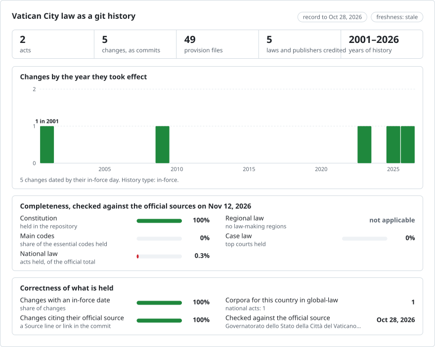

# Vatican City: law history in git

**English** · **[Oppure leggilo in italiano](README.md)**

<picture>
<source media="(prefers-color-scheme: dark)" srcset="data/effort-dark.svg">

</picture>

The law of Vatican City State as a git history: one file per provision, one commit per law on the day it took effect, and the law that made each change as the commit's author. `git blame` names the law behind every paragraph; `git log` lists every change to a provision; picking a date gives the text in force that day.

Part of [lexifina/global-law](https://github.com/lexifina/global-law), one git history for every country's law: this is Vatican City's national law, which global-law reads at `vatican-city/national/acts/`.

**What is in it now:** the Fundamental Law, the State's constitution, in its 4 versions since 22 February 2001 (the laws of 26 November 2000, 13 May 2023 and 31 July 2026, and the motu proprio of 19 November 2025), and the Law on the sources of law, N. LXXI of 1 October 2008, as enacted: 2 acts with 5 versions. Each act's `README.md` ([`legge-fondamentale/`](legge-fondamentale/README.md), [`legge-fonti-diritto/`](legge-fonti-diritto/README.md)) lists every provision, how often it changed and when; [`data/laws.csv`](data/laws.csv) lists every law in the record.

Each act is a folder with one file per article, title heading, preamble and closing formula (`legge-fondamentale/art-008.md` is Art. 8 of the Legge fondamentale dello Stato della Città del Vaticano). A Fundamental Law is replaced whole, not amended, and article numbers are those of the law in force on the day: the 2000 law has 20 articles, the 2023 law 24 and the 2026 law 25, so `art-008.md` need not hold the same provision under each.

The text is in Italian, the language of the State's laws, as the Governatorato publishes it. An English translation is not part of this record.

## Questions as git commands

| Question | Command |
| --- | --- |
| Every change to Article 8 of the Fundamental Law | `git log -p --word-diff -- legge-fondamentale/art-008.md` |
| Which law wrote each line of Article 8? | `git blame legge-fondamentale/art-008.md` |
| Every version of the Fundamental Law, with the day each took effect | `git log --format="%h %(trailers:key=In-force,valueonly,separator=) %an" -- legge-fondamentale ":(exclude)legge-fondamentale/README.md"` |
| Article 8 as in force on 1 January 2025 | `python tools/on.py 2025-01-01 legge-fondamentale art-008` |

**Outside git**, we also host this record publicly, for free:

- **[Ask Claude about Vatican law](https://global-law.lexifina.com/v1/try_claude?country=vatican-city)**: opens Claude with a first question ready.
- **[Ask ChatGPT](https://global-law.lexifina.com/v1/try_chatgpt?country=vatican-city)**: the same question in ChatGPT.
- **[Call the API in your browser](https://global-law.lexifina.com/v1/search_law?query=potere+legislativo&jurisdictions=vatican-city)**: a search of Vatican law for "potere legislativo", returned as JSON. See the [documentation here](https://lexifina.com/api/global-law).

Both assistants read the record through the free Global law connector (MCP, `https://global-law.lexifina.com/mcp`); the first time, the chat gives you the link that adds it. Ask in Italian or in English.

**Host it yourself easily.** All it takes is git and Python, and the tools run on your machine:

```sh
git clone --depth 1 https://github.com/lexifina/global-law && cd global-law
python3 tools/countries.py add vatican-city/national/acts
python3 tools/law.py show 2026-01-01 vatican-city/national/acts/legge-fondamentale/art-008.md
```

Opened in Claude Code, Cursor, VS Code or Codex, the clone also starts a local MCP server with the same tools ([MCP.md](https://github.com/lexifina/global-law/blob/main/MCP.md)).

## Dates

Each commit is dated at noon, Europe/Vatican, on the day the version took effect, and carries it in its `In-force:` trailer, with the day of promulgation (`Enacted:`) and, where known, of publication (`Published:`):

- every day comes from the law itself: 22 February 2001 for the 2000 law and 7 June 2023 for the 2023 law, as their final clauses say, and 1 January 2009 for LXXI (its art. 13); the 2026 law took effect "immediatamente" (art. 25, n. 3) on 31 July 2026, the day the Holy See Press Office Bulletin published it;
- the motu proprio of 19 November 2025 took effect on its publication in L'Osservatore Romano; the record uses 21 November 2025, the day the Press Office made it public (the newspaper's issue date was not checked);
- without such a clause, a Vatican law takes effect on the seventh day after its publication (LXXI, art. 2, n. 2); no law here needs that rule.

The first commit of each act is the act as enacted. A replacing Fundamental Law is credited only with the provisions whose words it changed, inserted or removed: Art. 1, for example, still reads as the 2023 law wrote it.

## How it is checked

- Every version is read back from git on the day it took effect and on the day before (`tools/check_repo.py`) and must match the corpus it was built from (`data/corpus.sha256`): 0 mismatches. Results are in [`REPRODUCE.md`](REPRODUCE.md).
- Every paragraph of the 2023 and 2026 laws was compared with the HTML copy on vatican.va (`tools/verify.py`): the 2026 law matches in full; in the 2023 law one comma in the preamble differs, and the Governatorato's text is kept.
- The 2025 change is replayed: the new art. 8, n. 1, word for word from the motu proprio as the Governatorato printed it, applied to the 2023 text.
- A second build from the same data gives identical hashes. History is append-only: no merge commits, no dates going backwards, no commit dated after the build.

## What it does not show

- **The first Fundamental Law (7 June 1929, n. I)** and the 2000 law's preamble: the official site has no text of them.
- **Annexes A to C** (the models of the flag, coat of arms and seal): drawings, left out.
- **Amendments of LXXI:** the official site publishes it as enacted and lists no amending act.
- **Other laws.** The codes LXXI applies (arts. 4 to 8: the Italian Civil Code, Criminal Code and Code of Criminal Procedure as received, and the Vatican Code of Civil Procedure of 1946) and the State's other laws, among them Law n. VIII of 2013 (complementary criminal provisions), are not here yet.

## Sources

| Source | Kind | Past versions | Notes |
| --- | --- | --- | --- |
| [Governatorato, Legislazione e normativa](https://www.vaticanstate.va/it/stato-e-governo/legislazione-e-normativa.html) | Official PDFs of each law as promulgated | no: each law as enacted, no consolidated texts | The text of every version, the motu proprio of 19 November 2025 from the Governatorato's page |
| [vatican.va](https://www.vatican.va/) | HTML copies of the 2023 and 2026 Fundamental Laws | no | Used only to check the text |
| [Sala Stampa della Santa Sede](https://press.vatican.va/content/salastampa/it/bollettino/pubblico/2026/07/31/0611.pdf) | Bulletin n. 0611 of 31 July 2026 | no | The publication day of the 2026 law |

## Licence

See [`LICENSE`](LICENSE). The legal texts come from the Governatorato dello Stato della Città del Vaticano, whose site states "Copyright © 2026 by Governatorato dello Stato della Città del Vaticano | Tutti i diritti riservati"; no open licence is offered for them. Lexifina's own contributions (the arrangement of the history, the commit messages, the tables and the tools) are CC0 1.0.

No AI model wrote, translated or corrected legal text; the fetch, parse and check scripts were written by an AI model (see [`REPRODUCE.md`](REPRODUCE.md)).

## More

From [lexifina/global-law](https://github.com/lexifina/global-law):

- [FEATURES.md](https://github.com/lexifina/global-law/blob/main/FEATURES.md): every feature, and what every corpus must support (`git blame`, `law.py`, the MCP tools)
- [FAQ.md](https://github.com/lexifina/global-law/blob/main/FAQ.md): questions and answers · [CONTRIBUTING.md](https://github.com/lexifina/global-law/blob/main/CONTRIBUTING.md): proposing changes · [MCP.md](https://github.com/lexifina/global-law/blob/main/MCP.md): the MCP server · [REPRODUCE.md](https://github.com/lexifina/global-law/blob/main/REPRODUCE.md): how it was built · [CHANGELOG.md](https://github.com/lexifina/global-law/blob/main/CHANGELOG.md)
- [FRESHNESS.md](https://github.com/lexifina/global-law/blob/main/FRESHNESS.md): how current each corpus is · [Monitoring](https://github.com/lexifina/global-law/tree/main/monitoring): whether updates are running · [WATCHING.md](https://github.com/lexifina/global-law/blob/main/WATCHING.md): how each official source is watched for changes
- [performance/](https://github.com/lexifina/global-law/tree/main/performance): how fast the tools are, measured
- [visualisations/](https://github.com/lexifina/global-law/tree/main/visualisations): charts and bridges across the world's law
- [Vulnerabilities](https://github.com/lexifina/global-law/tree/main/vulnerabilities): mistakes in legislation as published
