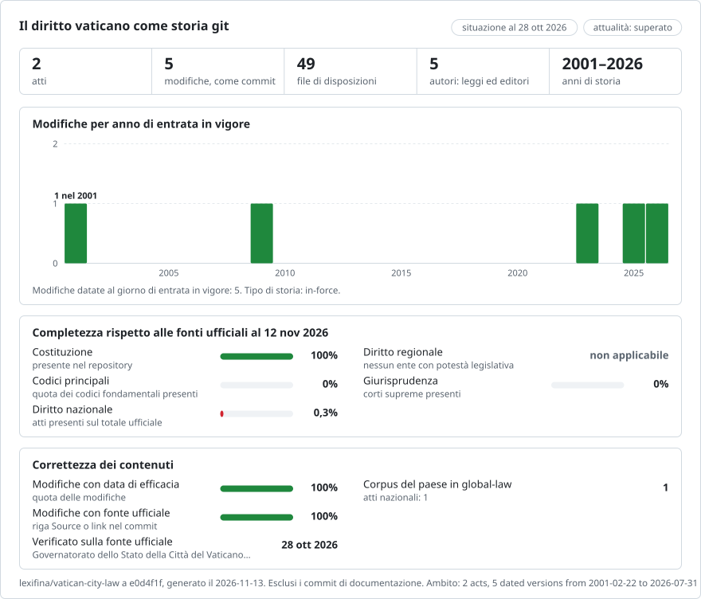

# Città del Vaticano: la storia del diritto in git

**Italiano** · [English](README.en.md)

<picture>
<source media="(prefers-color-scheme: dark)" srcset="data/it/effort-dark.svg">

</picture>

Fa parte di [lexifina/global-law](https://github.com/lexifina/global-law), un'unica storia git per il diritto di ogni paese: questo è il diritto nazionale della Città del Vaticano, che global-law legge in `vatican-city/national/acts/`.

Il diritto dello Stato della Città del Vaticano come storia git: un file per ogni disposizione, un commit per ogni legge nel giorno della sua entrata in vigore e, come autore del commit, la legge che ha introdotto ciascuna modifica. `git blame` indica la legge all'origine di ogni comma; `git log` elenca tutte le modifiche di una disposizione; `tools/on.py` restituisce il testo vigente in qualsiasi giorno.

Segue l'impostazione comune di [lexifina/global-law](https://github.com/lexifina/global-law), che lo colloca in `va/`. I testi sono i file ufficiali pubblicati dal Governatorato dello Stato della Città del Vaticano su [vaticanstate.va](https://www.vaticanstate.va/it/stato-e-governo/legislazione-e-normativa.html), in italiano, la lingua delle leggi dello Stato.

**Contenuto attuale**

| Cartella | Atto | Versioni | Storia |
| --- | --- | ---: | --- |
| `legge-fondamentale/` | Legge fondamentale dello Stato della Città del Vaticano (la costituzione dello Stato) | 4 | dal 2001-02-22 al 2026-07-31 |
| `legge-fonti-diritto/` | Legge sulle fonti del diritto, N. LXXI del 1° ottobre 2008 | 1 | 2009-01-01, testo originario |

**Legge fondamentale**

| In vigore dal | Autore | Che cosa è avvenuto |
| --- | --- | --- |
| 2001-02-22 | Legge fondamentale del 26 novembre 2000 (Giovanni Paolo II) | Ha sostituito la prima Legge fondamentale del 7 giugno 1929 |
| 2023-06-07 | Legge fondamentale del 13 maggio 2023 (Francesco) | Ha sostituito integralmente la legge del 2000 |
| 2025-11-21 | Motu proprio del 19 novembre 2025 (Leone XIV) | Art. 8, n. 1: il Presidente della Pontificia Commissione non deve più essere necessariamente un Cardinale |
| 2026-07-31 | Legge fondamentale del 31 luglio 2026 (Leone XIV) | Ha sostituito integralmente la legge del 2023, con entrata in vigore immediata |

Una Legge fondamentale viene sostituita per intero anziché modificata, quindi ogni nuova legge è un unico commit che riscrive i file dell'atto; blame mostra poi, articolo per articolo, quale legge ha scritto per ultima ciascun comma. Il `README.md` di ogni cartella elenca tutte le disposizioni, quante volte sono cambiate e quando.

## Le domande di un giurista come comandi git

| Domanda | Comando |
| --- | --- |
| Che cosa diceva l'art. 8 il 1° gennaio 2025? | `python tools/on.py 2025-01-01 legge-fondamentale art-008` |
| Lo stesso, con git puro (bash) | `git show $(git rev-list -1 --before="2025-01-01T23:59:59Z" main -- legge-fondamentale/art-008.md):legge-fondamentale/art-008.md` |
| Lo stesso, in PowerShell | `$r = git rev-list -1 --before="2025-01-01T23:59:59Z" main -- legge-fondamentale/art-008.md; git show "$($r):legge-fondamentale/art-008.md"` |
| Quale legge ha scritto ogni riga? | `git blame legge-fondamentale/art-008.md` |
| Ogni modifica, parola per parola | `git log -p --word-diff legge-fondamentale/art-008.md` |
| Tutte le leggi registrate, in ordine | `git log --reverse --format="%ad %an" --date=short main` |
| Tutto ciò che una legge ha modificato | `git show law/mp-2025-11-19` (i tag `law/<key>` contrassegnano il commit di ogni legge) |
| L'intera Legge fondamentale in una data | `python tools/on.py 2010-06-01 legge-fondamentale` |
| Quale legge ha dato a una disposizione il testo vigente in una data | `python tools/on.py --law 2024-01-01 legge-fondamentale art-008` |

I numeri degli articoli sono quelli della legge vigente nel giorno considerato: la legge del 2000 ha 20 articoli, quella del 2023 24 e quella del 2026 25, quindi `art-008.md` corrisponde a una disposizione diversa sotto ciascuna legge. Va letto insieme al tag della versione (`legge-fondamentale/<date>`). Dopo una ricostruzione, aggiornare i tag con `git fetch --force --tags`: un semplice fetch conserva i tag obsoleti.

## Date

- Ogni commit è datato alle **ore 12, fuso Europe/Vatican, del giorno in cui la modifica è entrata in vigore**. Il giorno figura anche nel trailer `In-force:`, letto dagli strumenti; anche il giorno della promulgazione (`Enacted:`) e, se noto, quello della pubblicazione (`Published:`) sono riportati come trailer.
- **Ogni data è tratta dalla legge stessa.** La legge del 2000 è entrata in vigore il 22 febbraio 2001 e quella del 2023 il 7 giugno 2023, come dispongono le rispettive clausole finali; la LXXI il 1° gennaio 2009 (art. 13). La legge del 2026 è entrata in vigore "immediatamente" (art. 25, n. 3) ed è stata pubblicata lo stesso giorno, il 31 luglio 2026, nel Bollettino della Sala Stampa della Santa Sede. Il motu proprio del 19 novembre 2025 è entrato in vigore il giorno della sua pubblicazione su L'Osservatore Romano; la registrazione usa il 21 novembre 2025, giorno in cui la Sala Stampa lo ha reso pubblico (la data del numero del quotidiano non è stata verificata).
- In mancanza di tale clausola, una legge vaticana entra in vigore il settimo giorno successivo alla sua pubblicazione (LXXI, art. 2, n. 2).
- `--before="YYYY-MM-DD"` da solo usa l'ora del vostro orologio, quindi prima di mezzogiorno una legge entrata in vigore in quel giorno può sfuggire. Usate `T23:59:59Z` come sopra, oppure lo strumento.

## Come viene verificato

- Ogni versione viene riletta da git nel giorno della sua entrata in vigore e nel giorno precedente (`tools/check_repo.py`); entrambe devono corrispondere a `corpus.json`. I risultati sono in `REPRODUCE.md`.
- **Confronto con una seconda copia ufficiale:** ogni comma delle leggi del 2023 e del 2026 è stato confrontato con il testo HTML su vatican.va. La legge del 2026 corrisponde interamente; nella legge del 2023 differisce una virgola, nel preambolo ("Vaticano che, il Trattato" nel PDF del Governatorato, qui mantenuto, contro "Vaticano, che il Trattato" su vatican.va).
- **La modifica del 2025 è stata riprodotta:** il nuovo art. 8, n. 1 è ripreso parola per parola dal motu proprio come stampato dal Governatorato e applicato al testo del 2023.
- Il repository viene ricostruito una seconda volta dagli stessi dati e deve produrre hash identici.

## Che cosa significa "autore"

L'autore di un commit è la legge che ha introdotto la modifica, con un indirizzo e-mail che non può esistere, così che `git blame` e `git log --author` indichino leggi. Il committer è sempre Lexifina.

- Il primo commit di ogni atto è l'atto nel testo originario.
- A una Legge fondamentale sostitutiva è attribuita ogni disposizione che ha modificato, inserito o soppresso. Una disposizione il cui testo non è cambiato mantiene l'autore precedente: gli artt. da 1 a 3 e 5, per esempio, risultano ancora come li ha scritti la legge del 2023.
- Blame attribuisce righe intere (un comma per riga). Usate `git log -p --word-diff` per vedere esattamente quali parole ha introdotto ciascuna modifica.

## Che cosa non contiene

- **La prima Legge fondamentale (7 giugno 1929, n. I)** e il preambolo della legge del 2000: il sito ufficiale non ne riporta il testo (la sua copia della legge del 2000 presenta il preambolo solo come sintesi giornalistica).
- **Gli allegati da A a C** (i modelli della bandiera, dello stemma e del sigillo) sono disegni e sono esclusi.
- **Le modifiche della LXXI:** il sito ufficiale la pubblica nel testo originario e non elenca atti modificativi. Se ne esistono, non sono qui.
- **Altre leggi.** La Città del Vaticano applica i codici italiani recepiti (civile, penale e le relative procedure, ai sensi degli artt. da 4 a 8 della LXXI) con proprie leggi di modifica; queste non sono ancora nella registrazione. La legge n. VIII del 2013 (norme complementari in materia penale) è già analizzata ma non ancora pubblicata qui, perché le leggi che l'hanno successivamente modificata non sono ancora state riprodotte.
- **Nessun OCR.** Ogni testo proviene dal livello di testo dello stesso editore. Cinque errori di carattere in quel livello sono stati corretti e sono elencati in REPRODUCE.md (per esempio "Ada Apostolicae" per "Acta Apostolicae").

## Come viene costruito

`tools/fetch.py` scarica una sola volta ogni file ufficiale con curl, in una cache indicizzata dallo sha256 del suo URL, e registra ogni richiesta. `tools/parse.py` legge solo quella cache: prende il livello di testo di ogni PDF (PyMuPDF), unisce le righe stampate in un comma per riga, suddivide la legge in preambolo, intestazioni dei titoli, articoli e formula finale, applica il motu proprio del 2025 e scrive `corpus.json`. `tools/verify.py` confronta il risultato con le copie di vatican.va. Il costruttore comune `tools/build.py` trasforma `corpus.json` nei commit. `REPRODUCE.md` elenca ogni fonte, comando, versione degli strumenti e scelta, nonché il risultato della ricostruzione con hash identici.

## Fonti

| Fonte | Che cosa fornisce | Uso |
| --- | --- | --- |
| [Governatorato, Legislazione e normativa](https://www.vaticanstate.va/it/stato-e-governo/legislazione-e-normativa.html) | PDF ufficiali di ogni legge come promulgata; la pagina del Governatorato che riporta il motu proprio del 19 novembre 2025. Nessun testo coordinato e nessuna versione datata. | Il testo di ogni versione |
| [vatican.va](https://www.vatican.va/) | Copie HTML delle Leggi fondamentali del 2023 e del 2026 | Verifica del testo analizzato |
| [Sala Stampa della Santa Sede](https://press.vatican.va/content/salastampa/it/bollettino/pubblico/2026/07/31/0611.pdf) | Bollettino n. 0611 del 31 luglio 2026 | Il giorno di pubblicazione della legge del 2026 |

Le leggi dello Stato sono pubblicate nel Supplemento per le leggi e disposizioni dello Stato della Città del Vaticano degli Acta Apostolicae Sedis e, quelle recenti, prima su L'Osservatore Romano. Il registro mondiale delle fonti segnala che dal 2024 la pubblicazione su vaticanstate.va ha efficacia legale; ciò non è stato confermato da un testo normativo.

## Licenza

Si veda [LICENSE](LICENSE). I testi normativi provengono dal Governatorato dello Stato della Città del Vaticano (vaticanstate.va), il cui sito riporta "Copyright © 2026 by Governatorato dello Stato della Città del Vaticano | Tutti i diritti riservati". Questo repository è privato. L'organizzazione, i messaggi, le tabelle e gli strumenti di Lexifina sono CC0.

Questo repository non costituisce consulenza legale.

Questa è una traduzione della versione inglese ([README.en.md](README.en.md)); in caso di differenze, prevale la versione inglese.

## Per saperne di più

Dal repository [lexifina/global-law](https://github.com/lexifina/global-law) (pagine in inglese):

- [FEATURES.md](https://github.com/lexifina/global-law/blob/main/FEATURES.md): tutte le funzionalità e ciò che ogni corpus deve supportare (`git blame`, `law.py`, strumenti MCP)
- [FAQ.md](https://github.com/lexifina/global-law/blob/main/FAQ.md): domande e risposte · [CONTRIBUTING.md](https://github.com/lexifina/global-law/blob/main/CONTRIBUTING.md): proporre una modifica · [MCP.md](https://github.com/lexifina/global-law/blob/main/MCP.md): server MCP · [REPRODUCE.md](https://github.com/lexifina/global-law/blob/main/REPRODUCE.md): come è stato realizzato · [CHANGELOG.md](https://github.com/lexifina/global-law/blob/main/CHANGELOG.md)
- [FRESHNESS.md](https://github.com/lexifina/global-law/blob/main/FRESHNESS.md): quanto è aggiornato ogni corpus · [Monitoraggio](https://github.com/lexifina/global-law/tree/main/monitoring): se gli aggiornamenti funzionano · [WATCHING.md](https://github.com/lexifina/global-law/blob/main/WATCHING.md): come ogni fonte ufficiale viene controllata per individuare le modifiche
- [performance/](https://github.com/lexifina/global-law/tree/main/performance): quanto sono veloci gli strumenti, misurato
- [visualisations/](https://github.com/lexifina/global-law/tree/main/visualisations): grafici e collegamenti attraverso il diritto di tutto il mondo
- [Vulnerabilità](https://github.com/lexifina/global-law/tree/main/vulnerabilities): errori nei testi così come sono stati pubblicati
