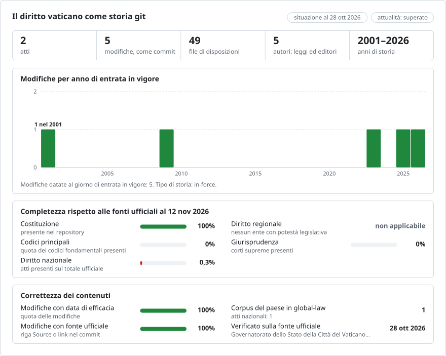

# Città del Vaticano: la storia del diritto in git

**Italiano** · **[Or read it in English](README.en.md)**

<picture>
<source media="(prefers-color-scheme: dark)" srcset="data/it/effort-dark.svg">

</picture>

Il diritto dello Stato della Città del Vaticano come storia git: un file per disposizione, un commit per ogni legge nel giorno della sua entrata in vigore e, come autore del commit, la legge che ha introdotto ciascuna modifica. `git blame` indica la legge all'origine di ogni comma; `git log` elenca ogni modifica di una disposizione; scegliendo una data si ottiene il testo vigente in quel giorno.

Fa parte di [lexifina/global-law](https://github.com/lexifina/global-law), un'unica storia git per il diritto di ogni Paese: questo è il diritto nazionale della Città del Vaticano, che global-law legge in `vatican-city/national/acts/`.

**Che cosa contiene ora:** la Legge fondamentale, la costituzione dello Stato, nelle sue 4 versioni dal 22 febbraio 2001 (le leggi del 26 novembre 2000, del 13 maggio 2023 e del 31 luglio 2026 e il motu proprio del 19 novembre 2025), e la Legge sulle fonti del diritto, N. LXXI del 1° ottobre 2008, nel testo originario: 2 atti con 5 versioni. Il `README.md` di ogni atto ([`legge-fondamentale/`](legge-fondamentale/README.md), [`legge-fonti-diritto/`](legge-fonti-diritto/README.md)) elenca ogni disposizione, quante volte è cambiata e quando; [`data/laws.csv`](data/laws.csv) elenca ogni legge dell'archivio.

Ogni atto è una cartella con un file per articolo, intestazione di titolo, preambolo e formula finale (`legge-fondamentale/art-008.md` è l'art. 8 della Legge fondamentale dello Stato della Città del Vaticano). Una Legge fondamentale viene sostituita per intero, non modificata, e i numeri degli articoli sono quelli della legge vigente nel giorno considerato: la legge del 2000 ha 20 articoli, quella del 2023 24 e quella del 2026 25, quindi `art-008.md` non contiene necessariamente la stessa disposizione sotto ciascuna legge.

Il testo è in italiano, la lingua delle leggi dello Stato, così come lo pubblica il Governatorato. Una traduzione in inglese non fa parte di questo archivio.

## Domande come comandi git

| Domanda | Comando |
| --- | --- |
| Ogni modifica dell'articolo 8 della Legge fondamentale | `git log -p --word-diff -- legge-fondamentale/art-008.md` |
| Quale legge ha scritto ogni riga dell'articolo 8? | `git blame legge-fondamentale/art-008.md` |
| Ogni versione della Legge fondamentale, con il giorno della sua entrata in vigore | `git log --format="%h %(trailers:key=In-force,valueonly,separator=) %an" -- legge-fondamentale ":(exclude)legge-fondamentale/README.md"` |
| L'articolo 8 nel testo vigente al 1° gennaio 2025 | `python tools/on.py 2025-01-01 legge-fondamentale art-008` |

**Fuori da git** pubblichiamo questo archivio anche online, gratuitamente:

- **[Chiedi a Claude del diritto vaticano](https://global-law.lexifina.com/v1/try_claude?country=vatican-city)**: apre Claude con una prima domanda già pronta.
- **[Chiedi a ChatGPT](https://global-law.lexifina.com/v1/try_chatgpt?country=vatican-city)**: la stessa domanda in ChatGPT.
- **[Chiama l'API dal browser](https://global-law.lexifina.com/v1/search_law?query=potere+legislativo&jurisdictions=vatican-city)**: una ricerca di "potere legislativo" nel diritto vaticano, con risposta in JSON. La documentazione è [qui](https://lexifina.com/api/global-law).

Entrambi gli assistenti leggono l'archivio tramite il connettore gratuito Global law (MCP, `https://global-law.lexifina.com/mcp`); la prima volta la chat ti dà il link per aggiungerlo. Puoi chiedere in italiano o in inglese.

**Ospitalo tu stesso, facilmente.** Bastano git e Python, e gli strumenti girano sul tuo computer:

```sh
git clone --depth 1 https://github.com/lexifina/global-law && cd global-law
python3 tools/countries.py add vatican-city/national/acts
python3 tools/law.py show 2026-01-01 vatican-city/national/acts/legge-fondamentale/art-008.md
```

Aperto in Claude Code, Cursor, VS Code o Codex, il clone avvia anche un server MCP locale con gli stessi strumenti ([MCP.md](https://github.com/lexifina/global-law/blob/main/MCP.md)).

## Date

Ogni commit è datato a mezzogiorno, ora del Vaticano (Europe/Vatican), al giorno in cui la versione è entrata in vigore, e lo riporta nel trailer `In-force:`, insieme al giorno della promulgazione (`Enacted:`) e, se noto, a quello della pubblicazione (`Published:`):

- ogni data è tratta dalla legge stessa: il 22 febbraio 2001 per la legge del 2000 e il 7 giugno 2023 per quella del 2023, come dispongono le rispettive clausole finali, e il 1° gennaio 2009 per la LXXI (art. 13); la legge del 2026 è entrata in vigore "immediatamente" (art. 25, n. 3) il 31 luglio 2026, giorno in cui l'ha pubblicata il Bollettino della Sala Stampa della Santa Sede;
- il motu proprio del 19 novembre 2025 è entrato in vigore con la pubblicazione su L'Osservatore Romano; l'archivio usa il 21 novembre 2025, giorno in cui la Sala Stampa lo ha reso pubblico (la data del numero del quotidiano non è stata verificata);
- in mancanza di tale clausola, una legge vaticana entra in vigore il settimo giorno successivo alla sua pubblicazione (LXXI, art. 2, n. 2); nessuna legge qui presente richiede questa regola.

Il primo commit di ogni atto è l'atto nel testo originario. A una Legge fondamentale sostitutiva sono attribuite solo le disposizioni di cui ha modificato, inserito o soppresso il testo: l'art. 1, per esempio, risulta ancora come lo ha scritto la legge del 2023.

## Come viene verificato

- Ogni versione viene riletta da git nel giorno della sua entrata in vigore e nel giorno precedente (`tools/check_repo.py`) e deve corrispondere al corpus da cui è stata costruita (`data/corpus.sha256`): 0 differenze. I risultati sono in [`REPRODUCE.md`](REPRODUCE.md).
- Ogni comma delle leggi del 2023 e del 2026 è stato confrontato con la copia HTML su vatican.va (`tools/verify.py`): la legge del 2026 corrisponde interamente; nella legge del 2023 differisce una virgola del preambolo, e si mantiene il testo del Governatorato.
- La modifica del 2025 è riprodotta: il nuovo art. 8, n. 1, ripreso parola per parola dal motu proprio come stampato dal Governatorato, è applicato al testo del 2023.
- Una seconda costruzione dagli stessi dati produce hash identici. La storia viene solo estesa: nessun commit di merge, nessuna data che torna indietro, nessun commit datato dopo la costruzione.

## Che cosa non mostra

- **La prima Legge fondamentale (7 giugno 1929, n. I)** e il preambolo della legge del 2000: il sito ufficiale non ne riporta il testo.
- **Gli allegati da A a C** (i modelli della bandiera, dello stemma e del sigillo): sono disegni, esclusi.
- **Le modifiche della LXXI:** il sito ufficiale la pubblica nel testo originario e non elenca atti modificativi.
- **Altre leggi.** I codici a cui rinvia la LXXI (artt. da 4 a 8: il Codice civile, il Codice penale e il Codice di procedura penale italiani recepiti, e il Codice di procedura civile vaticano del 1946) e le altre leggi dello Stato, tra cui la legge n. VIII del 2013 (norme complementari in materia penale), non sono ancora qui.

## Fonti

| Fonte | Tipo | Versioni precedenti | Note |
| --- | --- | --- | --- |
| [Governatorato, Legislazione e normativa](https://www.vaticanstate.va/it/stato-e-governo/legislazione-e-normativa.html) | PDF ufficiali di ogni legge come promulgata | no: ogni legge nel testo originario, nessun testo coordinato | Il testo di ogni versione, il motu proprio del 19 novembre 2025 dalla pagina del Governatorato |
| [vatican.va](https://www.vatican.va/) | Copie HTML delle Leggi fondamentali del 2023 e del 2026 | no | Usate solo per verificare il testo |
| [Sala Stampa della Santa Sede](https://press.vatican.va/content/salastampa/it/bollettino/pubblico/2026/07/31/0611.pdf) | Bollettino n. 0611 del 31 luglio 2026 | no | Il giorno di pubblicazione della legge del 2026 |

## Licenza

Vedi [`LICENSE`](LICENSE). I testi normativi provengono dal Governatorato dello Stato della Città del Vaticano, il cui sito riporta "Copyright © 2026 by Governatorato dello Stato della Città del Vaticano | Tutti i diritti riservati"; per essi non è offerta alcuna licenza aperta. I contributi propri di Lexifina (l'organizzazione della storia, i messaggi dei commit, le tabelle e gli strumenti) sono CC0 1.0.

Nessun modello di IA ha scritto, tradotto o corretto testo normativo; gli script di scaricamento, analisi e verifica sono stati scritti da un modello di IA (vedi [`REPRODUCE.md`](REPRODUCE.md)).

Questa è una traduzione della versione inglese ([README.en.md](README.en.md)); in caso di differenze, prevale la versione inglese.

## Per saperne di più

Dal repository [lexifina/global-law](https://github.com/lexifina/global-law) (pagine in inglese):

- [FEATURES.md](https://github.com/lexifina/global-law/blob/main/FEATURES.md): tutte le funzionalità e ciò che ogni corpus deve supportare (`git blame`, `law.py`, strumenti MCP)
- [FAQ.md](https://github.com/lexifina/global-law/blob/main/FAQ.md): domande e risposte · [CONTRIBUTING.md](https://github.com/lexifina/global-law/blob/main/CONTRIBUTING.md): proporre una modifica · [MCP.md](https://github.com/lexifina/global-law/blob/main/MCP.md): server MCP · [REPRODUCE.md](https://github.com/lexifina/global-law/blob/main/REPRODUCE.md): come è stato realizzato · [CHANGELOG.md](https://github.com/lexifina/global-law/blob/main/CHANGELOG.md)
- [FRESHNESS.md](https://github.com/lexifina/global-law/blob/main/FRESHNESS.md): quanto è aggiornato ogni corpus · [Monitoraggio](https://github.com/lexifina/global-law/tree/main/monitoring): se gli aggiornamenti funzionano · [WATCHING.md](https://github.com/lexifina/global-law/blob/main/WATCHING.md): come ogni fonte ufficiale viene controllata per individuare le modifiche
- [performance/](https://github.com/lexifina/global-law/tree/main/performance): quanto sono veloci gli strumenti, misurato
- [visualisations/](https://github.com/lexifina/global-law/tree/main/visualisations): grafici e collegamenti attraverso il diritto di tutto il mondo
- [Vulnerabilità](https://github.com/lexifina/global-law/tree/main/vulnerabilities): errori nei testi così come sono stati pubblicati
